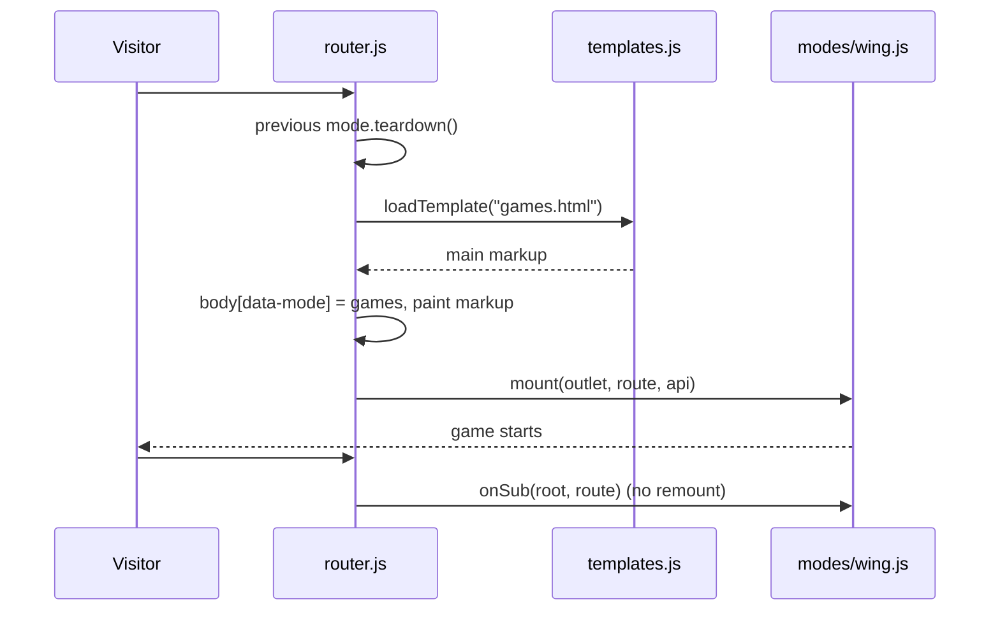

# The Dropdown Archive

**17 exhibits. 3 wings. 1 interaction.**

A dropdown is the smallest serious interaction on the web: you commit to one thing out of many,
in one motion. This archive keeps that motion under a lamp — its taxonomy (Wing I), the games it
turns into (Wing II), and the loud aesthetic it inherited from 1999 (Wing III).

No build step, no framework, no dependencies. Plain HTML, CSS and ES modules, served as they are.

---

## Running it

ES modules and the wing loader use `fetch`, so the pages must come from an HTTP origin —
opening `index.html` from the file system will not work (the app detects this and tells you what
to run).

```bash
python -m http.server 8000     # then open http://localhost:8000/index.html
```

Any static server works (`npx serve`, `php -S localhost:8000`, GitHub Pages). There is nothing to
compile and nothing to install.

---

## The collection

Every exhibit has an accession number, and every accession number is a route: `#/education/dd-006`.

### Wing I — Education (11 exhibits)

| Accession | Exhibit | What it demonstrates |
| --- | --- | --- |
| DD-001 | Native select | The `<select>` you should reach for first, and what you get for free |
| DD-002 | Custom listbox | A styled listbox that still speaks WAI-ARIA |
| DD-003 | Anatomy of a dropdown | Trigger, listbox, option, value, disclosure — the parts and their names |
| DD-004 | Mega menu | Multi-column panels, and the escape hatch they usually forget |
| DD-005 | Multi-select | Chips, a truthful closed state, and a clear-all |
| DD-006 | Searchable combobox | `aria-autocomplete="list"`, live result counts, honest empty states |
| DD-007 | Grouped options | `<optgroup>` structure surviving into the accessibility tree |
| DD-008 | Keyboard-only operation | Type-ahead, Home/End, `aria-activedescendant`, focus return |
| DD-009 | Accessible naming | Label, description, error — the three relationships a select needs |
| DD-010 | Anti-patterns | Divs-as-selects, hover menus, and why they fail |
| DD-011 | Choosing a pattern | A decision table for picking the right control |

### Wing II — Games (3 exhibits)

| Accession | Game | Mechanic |
| --- | --- | --- |
| DD-012 | Find the Path | Five dropdowns, one correct sequence, yes/no feedback only. **Advanced** mode drifts the menus while you aim. |
| DD-013 | Hacker Puzzle | Six flags hidden six ways: one credential split across four devtools surfaces, then base64, a Caesar shift whose key is left in the page, raw hex, a reversed ROT13, and all three stacked. No plaintext answer is stored anywhere in the source. |
| DD-014 | Lazy Drop | An idle game measured in selections: tiers, upgrades, and a banked ledger. |

### Wing III — Retro 1999 (3 exhibits)

| Accession | Exhibit | Contents |
| --- | --- | --- |
| DD-015 | Three selects, 1999 | Period-correct controls, tables and bevels |
| DD-017 | Hit counter and marquee | A counter that really counts, and a marquee that really scrolls |
| DD-016 | Guestbook | Signs kept in `localStorage`, worst first |

Preserved, not mocked: the wing is loud on purpose, and still keeps its landmarks, labels and
`prefers-reduced-motion` behaviour.

---

## Records

Seventeen records are earnable across all three wings. They are kept in this browser only, and the
record book opens from the footer, the home page, or the `R` key. The book counts them from the
catalogue rather than spelling the number out, so it cannot go stale again.

| Accession | Record | Earned by |
| --- | --- | --- |
| AC-01 | Path Found | Clearing Find the Path on standard |
| AC-02 | Steady Hand | Clearing Find the Path while the menus move |
| AC-03 | Root Access | Recovering the hidden credential (FLAG-01) |
| AC-04 | Read the Fine Source | Finding all four fragments before guessing |
| AC-05 | Point Collector | Banking 1,000 points in Lazy Drop |
| AC-06 | Small Print | Raising Lazy Drop to tier 5 |
| AC-07 | Signed the Guestbook | Leaving a mark in 1999 |
| AC-08 | Catalogue Read | Opening every exhibit in Education |
| AC-09 | Full Tour | Visiting all three wings in one sitting |
| AC-10 | Lightning Drop | Picking the one prize row out of the Long Menu's 500 |
| AC-11 | The Whole Shelf | Clearing all fifty question sets in Find the Path |
| AC-12 | Not Encryption | Decoding the base64 packet (FLAG-02) |
| AC-13 | Shifted Thinking | Finding the shift key in the page and undoing the intercept (FLAG-03) |
| AC-14 | Byte Reader | Reading the hex flag two digits at a time (FLAG-04) |
| AC-15 | Read It Backwards | Undoing the ROT13 and the reversal in the right order (FLAG-05) |
| AC-16 | Three Layers Deep | Stripping hex, then base64, then ROT13 off the last flag (FLAG-06) |
| AC-17 | Root Kit | Recovering all six flags |

---

## Keyboard

| Key | Action |
| --- | --- |
| `Ctrl`/`Cmd` + `K`, or `/` | Open the index (command palette) |
| `R` | Open the record book |
| `↑` `↓` `Home` `End` | Move within an open list |
| `A`–`Z` | Type-ahead inside a list |
| `Enter` `Space` | Open / commit |
| `Esc` | Close without committing |
| `Tab` | Leave the control, closing it |

---

## How it is built

```
index.html              shell: header, <main id="main-content">, footer
home.html               wing 0 — the desk at the entrance
education.html          Wing I   ┐ wing fragments: fetched into #main-content,
games.html              Wing II  ├ never loaded as documents, so they stay
retro-1999.html         Wing III ┘ plain HTML rather than template files
css/
  tokens.css            design system: palette, type, spacing, motion, reset
  select.css            the dropdown components (native upgrade, listbox, mega, combobox)
  nav.css               header, skip link, theme toggle
  main.css              shell + home
  education.css         Wing I     ┐ one stylesheet per wing, keyed off
  games.css             Wing II    ├ body[data-mode], which the router sets
  retro-1999.css        Wing III   ┘
js/
  main.js               wiring only: theme, palette, global keys, router start
  core/
    router.js           hash router: teardown → load → paint → mount
    modes.js            the route table (home, education, games, retro)
    templates.js        fetch + cache a wing fragment, hand back its <main>
    catalogue.js        the index, read from data-* in the wing markup
    theme.js            daylight / vault, persisted
    achievements.js     the record book
  ui/
    select.js           ArchiveSelect — upgrades a native <select>
    menu.js             createMenu — the shared listbox / keyboard model
    palette.js          the index dialog
  modes/                one module per wing: mount(root, route, api) / onSub / teardown
  games/                find-path, hacker, lazy-drop — mounted by modes/games.js
  lib/store.js          namespaced localStorage helper
```

### One route, start to finish



Three conventions hold the whole thing together:

- **The markup is the index.** Every exhibit carries `data-exhibit`, `data-accession`,
  `data-title` and `data-route`. The palette, the home page and the deep links all read that one
  source, so nothing can drift out of date.
- **A mode owns its listeners.** Every `mount()` keeps an `AbortController` in its closure and
  `teardown()` aborts it, so a wing cannot leave handlers, timers or animation frames behind on a
  document it no longer owns.
- **State is namespaced.** Everything persists through `js/lib/store.js` under
  `dropdown-archive:<key>` — `theme`, `achievements`, `find-path`, `lazy-drop`, `retro-counter`,
  `retro-guestbook`. No key is written directly.

### Accessibility

Both dropdown implementations (a native `<select>` upgrade and a generic listbox) follow the same
WAI-ARIA combobox model: `role="combobox"` + `role="listbox"` + `aria-activedescendant`, roving
type-ahead, `Home`/`End`, `Esc` returning focus to the trigger, and a single `:focus-visible` ring.
The mega menu collapses to a bottom sheet on narrow screens. Skip link, landmarks, live regions
for game feedback and `prefers-reduced-motion` are wired throughout; the retro wing stays loud
without becoming unusable.

---

## Extending it

**Add an exhibit** — write a `<section class="exhibit" id="dd-0XX" data-exhibit="demo"
data-accession="DD-0XX" data-title="…" data-route="/education/dd-0XX">` in the wing file. It
appears in the index, the wing navigation and the deep-link router with no further registration.

**Add a game** — export `{ mount(root, route, api), teardown() }` from `js/games/<name>.js`, add a
`data-exhibit="game"` section to `games.html`, and map its sub-route in `js/modes/games.js`.

**Add a wing** — a fragment file, a mode module in `js/modes/`, entries in `WINGS`
(`js/core/catalogue.js`) and `MODES` (`js/core/modes.js`), and a `body[data-mode="…"]` accent in
`css/tokens.css`.

---

## License

MIT — see [LICENSE](LICENSE).
