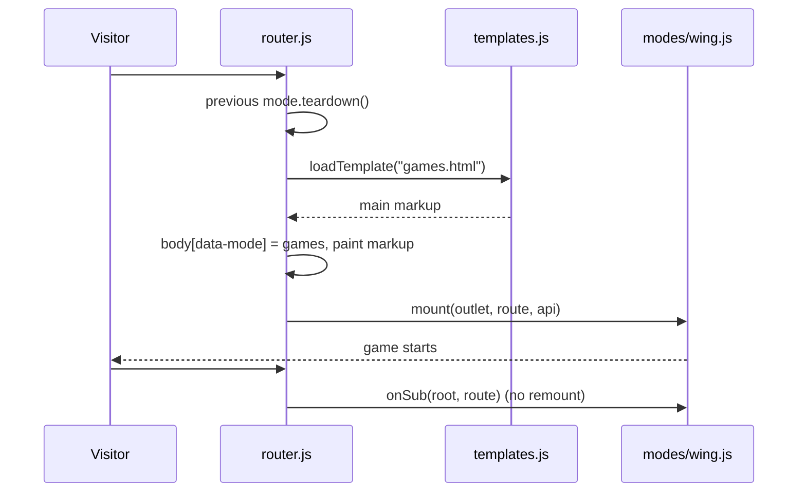

# The Dropdown Archive

**17 exhibits. 3 wings. 1 interaction.**

A dropdown is the smallest serious interaction on the web: you commit to one thing out of many,
in one motion. This archive keeps that motion under a lamp — its taxonomy (Wing I), the games it
turns into (Wing II), and the loud aesthetic it inherited from 1999 (Wing III).

No build step, no framework, no dependencies. Plain HTML, CSS and ES modules, served as they are.

---

## Running it

ES modules and the wing loader use `fetch`, so the pages must come from an HTTP origin —
opening `index.html` from the file system will not work (the app detects this and tells you what
to run).

```bash
python -m http.server 8000     # then open http://localhost:8000/index.html
```

Any static server works (`npx serve`, `php -S localhost:8000`, GitHub Pages). There is nothing to
compile and nothing to install.

One trap, because it wastes an afternoon: `http.server` answers with `Last-Modified` alone, and
Chrome counts a module it fetched a minute ago as still fresh. An edit can therefore sit invisible
behind an ordinary reload, tests and all — the page runs the code that is gone. Hard-reload
(Ctrl+Shift+R) after changing any module, and for a headless run give the browser a throwaway
profile (the flags are under [Tests](#tests)), because a profile that starts empty is the only cache
that cannot lie to you.

---

## Tests

`/tests/` is a page, not a toolchain. It has no dependencies because the site has no dependencies,
and adding a bundler to test eleven files would cost more than it saves.

```bash
python -m http.server 8000     # then open http://localhost:8000/tests/
```

Assertions over the storage layer, the router, both dropdown components and the scrollbar and press
guards they share, the record book, the cipher data, all three games mounted into the real
`games.html`, and the education wing's hand-wired combobox. `?json` prints the report as JSON.

`.github/workflows/ci.yml` runs that same page headless: a browser loads `/tests/?json`, and the
run fails if the report is empty or any case fails. It then loads every route the same way and
fails on an uncaught error or a wing whose template could not be found. Nothing is installed to
make that work, which is the point — a static server and a browser are the whole toolchain, so the
same check is cheap enough to run before committing:

```bash
python -m http.server 8000
chromium --headless --dump-dom --virtual-time-budget=120000 http://127.0.0.1:8000/tests/?json
```

Give that browser a profile of its own whenever an ordinary Chrome window is already open — add
`--disk-cache-size=1 --user-data-dir="$TMPDIR/dropdown-archive-chrome"`. On the default profile
Chrome hands the load to the open window and prints an empty document, or serves the wing modules
out of its cache and reports the totals of the run *before* yours. A CI runner always starts clean,
which is the only reason `ci.yml` needs neither flag, and its refusal of a zero-test report is what
stops an empty dump from reading as a pass.

There is no linter, formatter or type checker configured, because there is no toolchain to
configure one inside. The single Node-facing file in the repo is `tests/package.json` — one key,
`"type": "module"`, there so `tests/answer-key.js` can be the decoder table both guards import
instead of one they each copy (see its header for why `.mjs` could not do that job).
`.editorconfig` carries the indentation and line-ending rules that the files already follow, and
the workflow enforces the two conventions a linter would usually own: every tracked `.js` and
`.mjs` file parses, and nothing under `js/` evaluates code it assembled at runtime. It also runs
the sweep described below, so a leak cannot wait for someone to remember it.

Two things it is deliberately arranged to catch:

- **Docs that have drifted from data.** The record book once announced nine records while listing
  seventeen. The README's counts are now checked against the catalogue and the achievement list.
- **Answers leaking into the source.** DD-013 hides six flags, so a test decodes each one at run
  time and asserts that no served file — the suite's own included — holds a plaintext answer, or
  more of FLAG-01's four fragments than that file's surface is meant to show. A page cannot list a
  directory, so that test follows the site's own edges and reads whatever it reaches;
  `node tests/leak-check.mjs` hunts the same answers over every file git can see, committed or not,
  which is the rest of the tree. Both of them decode through the one table in
  `tests/answer-key.js`, so "the same answers" means the same code rather than the same recipe
  written twice. The suite never writes an answer down, which is why it can ship
  without becoming the answer key.

---

## The collection

Every exhibit has an accession number, and every accession number is a route: `#/education/dd-006`.

### Wing I — Education (11 exhibits)

| Accession | Exhibit | What it demonstrates |
| --- | --- | --- |
| DD-001 | Native select | The `<select>` you should reach for first, and what you get for free |
| DD-002 | Custom listbox | A styled listbox that still speaks WAI-ARIA |
| DD-003 | Anatomy of a dropdown | Trigger, listbox, option, value, disclosure — the parts and their names |
| DD-004 | Mega menu | Multi-column panels, and the escape hatch they usually forget |
| DD-005 | Multi-select | Chips, a truthful closed state, and a clear-all |
| DD-006 | Searchable combobox | `aria-autocomplete="list"`, live result counts, honest empty states |
| DD-007 | Grouped options | `<optgroup>` structure surviving into the accessibility tree |
| DD-008 | Keyboard-only operation | Type-ahead, Home/End, `aria-activedescendant`, focus return |
| DD-009 | Accessible naming | Label, description, error — the three relationships a select needs |
| DD-010 | Anti-patterns | Divs-as-selects, hover menus, and why they fail |
| DD-011 | Choosing a pattern | A decision table for picking the right control |

### Wing II — Games (3 exhibits)

| Accession | Game | Mechanic |
| --- | --- | --- |
| DD-012 | Find the Path | Five dropdowns, one correct sequence, yes/no feedback only. **Advanced** mode drifts the menus while you aim. |
| DD-013 | Hacker Puzzle | Six flags hidden six ways: one credential split across four devtools surfaces, then base64, a Caesar shift whose key is left in the page, raw hex, a reversed ROT13, and all three stacked. No plaintext answer is stored anywhere in the source. |
| DD-014 | Lazy Drop | An idle game measured in selections: tiers, upgrades, and a banked ledger. |

### Wing III — Retro 1999 (3 exhibits)

| Accession | Exhibit | Contents |
| --- | --- | --- |
| DD-015 | Three selects, 1999 | Period-correct controls, tables and bevels |
| DD-017 | Hit counter and marquee | A counter that really counts, and a marquee that really scrolls |
| DD-016 | Guestbook | Signs kept in `localStorage`, worst first |

Preserved, not mocked: the wing is loud on purpose, and still keeps its landmarks, labels and
`prefers-reduced-motion` behaviour.

---

## Records

Seventeen records are earnable across all three wings. They are kept in this browser only, and the
record book opens from the footer, the home page, or the `R` key. The book counts them from the
catalogue rather than spelling the number out, so it cannot go stale again.

| Accession | Record | Earned by |
| --- | --- | --- |
| AC-01 | Path Found | Clearing Find the Path on standard |
| AC-02 | Steady Hand | Clearing Find the Path while the menus move |
| AC-03 | Root Access | Recovering the hidden credential (FLAG-01) |
| AC-04 | Read the Fine Source | Holding all four fragments, whether you found them or a hint rung handed them over |
| AC-05 | Point Collector | Banking 1,000 points in Lazy Drop |
| AC-06 | Small Print | Raising Lazy Drop to tier 5 |
| AC-07 | Signed the Guestbook | Leaving a mark in 1999 |
| AC-08 | Catalogue Read | Opening every exhibit in Education |
| AC-09 | Full Tour | Visiting all three wings in one sitting |
| AC-10 | Lightning Drop | Picking the one prize row out of the Long Menu's 500 |
| AC-11 | The Whole Shelf | Clearing all fifty question sets in Find the Path |
| AC-12 | Not Encryption | Decoding the base64 packet (FLAG-02) |
| AC-13 | Shifted Thinking | Finding the shift key in the page and undoing the intercept (FLAG-03) |
| AC-14 | Byte Reader | Reading the hex flag two digits at a time (FLAG-04) |
| AC-15 | Read It Backwards | Undoing the ROT13 and the reversal in the right order (FLAG-05) |
| AC-16 | Three Layers Deep | Stripping hex, then base64, then ROT13 off the last flag (FLAG-06) |
| AC-17 | Root Kit | Recovering all six flags |

---

## Keyboard

| Key | Action |
| --- | --- |
| `Ctrl`/`Cmd` + `K`, or `/` | Open the index (command palette) |
| `R` | Open the record book |
| `↑` `↓` `Home` `End` | Move within an open list |
| `A`–`Z` | Type-ahead inside a list |
| `Enter` `Space` | Open / commit |
| `Esc` | Close without committing |
| `Tab` | Leave the control, closing it |

---

## How it is built

```
index.html              shell: header, <main id="main-content">, footer
home.html               wing 0 — the desk at the entrance
education.html          Wing I   ┐ wing fragments: fetched into #main-content,
games.html              Wing II  ├ never loaded as documents, so they stay
retro-1999.html         Wing III ┘ plain HTML rather than template files
css/
  tokens.css            design system: palette, type, spacing, motion, reset
  select.css            the dropdown components (native upgrade, listbox, mega, combobox)
  nav.css               header, skip link, theme toggle
  main.css              shell + home
  education.css         Wing I     ┐ one stylesheet per wing, keyed off
  games.css             Wing II    ├ body[data-mode], which the router sets
  retro-1999.css        Wing III   ┘
js/
  main.js               wiring only: theme, palette, global keys, router start
  core/
    router.js           hash router: teardown → load → paint → mount
    modes.js            the route table (home, education, games, retro)
    templates.js        fetch + cache a wing fragment, hand back its <main>
    catalogue.js        the index, read from data-* in the wing markup
    theme.js            daylight / vault, persisted
    achievements.js     the record book
  ui/
    select.js           ArchiveSelect — upgrades a native <select>
    menu.js             createMenu — the shared listbox / keyboard model
    scrollbar.js        is a mousedown on the panel's own scrollbar? (both widgets)
    presses.js          is the pointer pressing inside the panel right now? (both widgets)
    palette.js          the index dialog
  modes/                one wing each: mount(root, route, api) → cleanup, optional onSub
  games/                find-path, hacker, lazy-drop — mounted by modes/games.js
  lib/store.js          namespaced localStorage helper
```

### One route, start to finish



Three conventions hold the whole thing together:

- **The markup is the index.** Every exhibit carries `data-exhibit`, `data-accession`,
  `data-title` and `data-route`. The palette, the home page and the deep links all read that one
  source, so nothing can drift out of date.
- **A mode owns its listeners.** A wing removes every handler it binds to `document` or `window`
  before it leaves, so it cannot leave handlers, timers or animation frames behind on a document it
  no longer owns. Each wing picks its own mechanism — `js/modes/home.js` keeps an `AbortController`
  in its closure and aborts it, `js/modes/education.js` and `js/modes/retro.js` collect closures in
  a `cleanups` array — and every `mount()` hands back one cleanup function, which the router calls
  before it loads the next wing (`js/core/router.js:15`). One level down, a game returns
  `{ unmount, onShow, onHide }` and its `unmount()` pairs each `addEventListener` with a
  `removeEventListener`. Listeners bound to elements the wing built itself are not tracked: they go
  away with the markup. `js/core/modes.js` documents the same rule for the `api` it hands out —
  anything listening on the host has to be dropped at teardown.
- **State is namespaced.** Everything persists through `js/lib/store.js` under
  `dropdown-archive:<key>` — `theme`, `achievements`, `find-path`, `lazy-drop`, `retro-counter`,
  `retro-guestbook`. No key is written directly.

### Accessibility

Both dropdown implementations (a native `<select>` upgrade and a generic listbox) follow the same
WAI-ARIA combobox model: `role="combobox"` + `role="listbox"` + `aria-activedescendant`, roving
type-ahead, `Home`/`End`, `Esc` returning focus to the trigger, and a single `:focus-visible` ring.
A click anywhere outside an open widget closes it, and a `Tab` out of one closes it without dragging
focus back to the trigger — a keyboard visitor leaving a listbox mid-page should land on the next
control, not several controls earlier. So does focus itself moving away, to the index palette or
anywhere else: both components listen for `focusout` and stay closed, leaving focus where the visitor
put it. A pick never moves focus by accident: nothing inside an open list takes focus, so
`mousedown` inside one is cancelled, which keeps the focus on the trigger and the click on its
option — the panel's own scrollbar excepted, since cancelling it there would stop a thumb from being
dragged (`js/ui/scrollbar.js`). That spared press is caught rather than trusted: the browser moves
focus off a control whose list is open for any press inside it, so a widget that can see its own
press is in progress puts focus back on the trigger instead of reading the move as a departure, which
is what used to snap the menu shut on top of the thumb (`js/ui/presses.js`). The mega menu collapses
to a bottom sheet on narrow screens.
Skip link, landmarks, live regions for game feedback and `prefers-reduced-motion` are wired
throughout; the retro wing stays loud without becoming unusable.

---

## Extending it

**Add an exhibit** — write a `<section class="exhibit" id="dd-0XX" data-exhibit="demo"
data-accession="DD-0XX" data-title="…" data-route="/education/dd-0XX">` in the wing file. It
appears in the index, the wing navigation and the deep-link router with no further registration.

**Add a game** — `export default { id, mount(root, api) }` from `js/games/<name>.js`, where `mount`
returns `{ unmount, onShow?, onHide? }` (or just a cleanup function). `onShow` and `onHide` fire
when the visitor switches tabs inside the wing, which does not remount the game. Add a
`data-exhibit="game"` section to `games.html`, and map its sub-route in `js/modes/games.js`.

**Add a wing** — a fragment file, a mode module in `js/modes/` exporting
`mount(root, route, api)` (returning one cleanup function) and optional `onSub(root, route)`,
entries in `WINGS` (`js/core/catalogue.js`) and `MODES` (`js/core/modes.js`), and a
`body[data-mode="…"]` accent in `css/tokens.css`.

---

## License

MIT — see [LICENSE](LICENSE).
